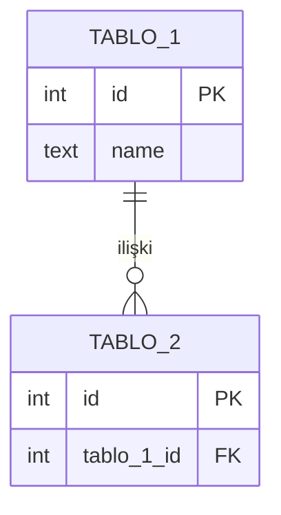

<!--
Bu dosyayı kendi reponda README.md olarak kaydet ve dönem boyunca doldur.
Köşeli parantezli yerleri kendi projenle değiştir.
Final teslimde bu README, projeni ilk kez gören birinin anladığı tek kapı olacak.
-->

# [Proje Adı]

[Tek cümlede projen ne yapıyor.]

**Öğrenci:** [Ad Soyad] · **Program:** [YZO / Robotik] · BLP 105 / BLP 1005, Güz 2026-2027

---

## Problem

[Hangi gerçek problemi çözüyorsun? 3-5 cümle. Teknik olmayan biri de anlasın.]

## Veri kaynağı

| | |
|---|---|
| Kaynak | [adı ve linki] |
| Lisans / kullanım koşulu | [varsa] |
| Satır sayısı | [kaç satır] |
| İndirme tarihi | [tarih] |

[Veriyi neden seçtin, içinde ne var, hangi sütunlarda eksik veri vardı?]

## Veritabanı şeması



[ERD'ni buraya çiz. GitHub Mermaid'i otomatik render eder.]

### Normalizasyon notu

[Hangi tabloları neden böldün? Hangi fonksiyonel bağımlılıkları gördün? Bilinçli bıraktığın bir denormalizasyon varsa gerekçesi.]

## Kurulum

```bash
createdb [veritabani_adi]
psql -d [veritabani_adi] -f migrations/001_create_tables.sql
psql -d [veritabani_adi] -f data/seed/seed.sql
```

## Örnek sorgular

### [Sorunun iş dilindeki hali]

```sql
SELECT ...
```

[Sonuç ne anlama geliyor, bir iki cümle.]

### [İkinci soru]

```sql
SELECT ...
```

## Görünümler

| View | Ne işe yarar |
|---|---|
| `[view_adi]` | [açıklama] |

## İndeks

```sql
CREATE INDEX ... ;
```

[Neden bu indeks? `EXPLAIN ANALYZE` çıktısını önce ve sonra koy.]

## Güvenlik

[Tanımladığın rol ve neden o yetkileri verdiğin.]

## Yapay zeka bileşeni

[jsonb / pgvector / text-to-SQL, hangisini seçtin, neden, nasıl çalışıyor, sınırları ne?]

## Demo

[90 saniyelik video veya GIF buraya.]

## Ne öğrendim

[Dönem boyunca en çok zorlandığın şey, en çok şaşırdığın şey, bir daha yapsan farklı yapacağın şey. Dürüst yaz, bu bölüm projenin en çok okunan kısmı olur.]

## Yapay zeka kullanım beyanı

[Dönem boyunca hangi araçları nerede kullandın.]
