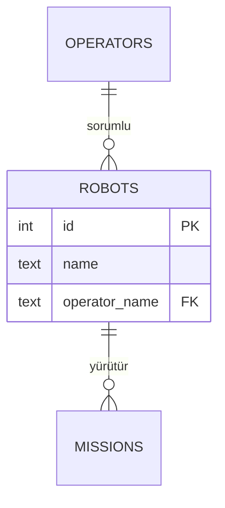

# Ödev 3: ERD ve normalizasyon

> **Bu ödev henüz açılmadı.** Konusu belli, tarihi değil. Şu an aktif olan tek ödev [Ödev 1](../week-05/odev.md), son teslim 23 Ekim 2026 Cuma. Buradaki yönergeyi şimdiden okuyabilirsin.

Hafta 7 konusu. 100 puan.

**Son teslim: tarih sonra duyurulacak, ders saatinden önce GitHub'da. Kâğıt rapor ara sınav haftasındaki derste.**

## Amaç

Kendi senaryonu bir E-R modeline dönüştürmek ve o modeli 3NF'ye taşımak. Bu ödev aynı zamanda **ara sınav hazırlığın.**

## Yapılacaklar

### Bölüm 1: ERD (zorunlu)

`docs/erd.md` dosyasında Mermaid ile ERD'ni çiz. GitHub bunu otomatik render eder, yani PR'da diyagramı görebileceğim.

ERD'nde olması gerekenler:

- [ ] Bütün varlıklar (en az 3 tablo)
- [ ] Her varlığın nitelikleri, veri tipleriyle
- [ ] Birincil anahtarlar (PK) işaretli
- [ ] Yabancı anahtarlar (FK) işaretli
- [ ] Her ilişkinin kardinalitesi (1-1, 1-N, M-N)
- [ ] M-N ilişkin varsa ara tablosu

### Bölüm 2: Normalizasyon raporu (zorunlu)

`docs/normalizasyon.md` dosyasında:

- [ ] **Başlangıç hali:** ham CSV'nde hangi sütunlar vardı? (tek tablo olarak yaz)
- [ ] **Anomaliler:** bu tek tabloda hangi ekleme, güncelleme ve silme anomalileri olurdu? Her biri için somut bir örnek ver
- [ ] **Fonksiyonel bağımlılıklar:** hangi sütun hangisini belirliyor? (`siparis_id → musteri_adi` gibi)
- [ ] **1NF, 2NF, 3NF adımları:** her adımda hangi tabloyu neden böldün?
- [ ] **Bilinçli denormalizasyon:** bıraktığın bir tekrar varsa gerekçesi

### Bölüm 3: Anahtar tartışması (zorunlu, kısa)

Ders veritabanında `operators` tablosunun birincil anahtarı doğrudan **isim** (`operator_name`). Bu bir natural key.

Raporunda iki soruyu cevapla:

1. Aynı isimde ikinci bir operatör işe alınırsa ne olur?
2. Kendi projende natural key mi yoksa surrogate key (`id`) mi kullanacaksın, neden?

## Teslim

| Ne | Nerede |
|---|---|
| ERD | `docs/erd.md` |
| Normalizasyon raporu | `docs/normalizasyon.md` |
| Rapor (dijital) | `odevler/odev-03/rapor.md` |
| PR | Branch `odev-03`, reviewer: gizemturker |
| **Rapor (kâğıt)** | **Hafta 8 dersinde elden** |

## Değerlendirme

[RUBRIK.md bölüm 1](../../RUBRIK.md). Bu ödevde "Doğruluk" ölçütü ERD'nin ve normalizasyon adımlarının doğruluğu olarak okunur.

> Bu ödev ara sınavının temelidir. Hafta 8'de bu ERD'yi savunacaksın.
